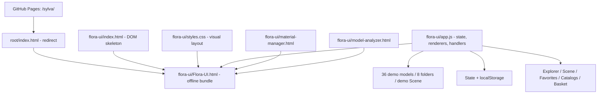

# Flora UI V2 - карта интерфейса для Codex

> Актуализировано: 20.10.2026. Источник: ветка `flora-ui-v2`, папка `flora-ui/`. Это карта **браузерного HTML/CSS/JS-прототипа**, а не техническая карта рабочего Python/PySide6-плагина 3ds Max.
>
> Важно для актуализации требований: после 20.10.2026 владелец утвердил новый Qt Edit Properties (вертикальная форма, подписи над полями, чекбоксы сред без внутренней прокрутки), заголовки без стрелок, единые dropdown, адаптивный font slider и компактные Basket/Explorer/Filters. Эти решения записаны в [§20 основного описания Flora](https://docs.google.com/document/d/19MQLTbmyikvPj2wCLwIvuSqF3sdwJ8YUlSEtsMSkbZ0/edit), но **не являются описанием уже изменённого HTML/JS**. Ниже дана карта фактического веб-кода на 20.10.2026.
>
> Главное правило: **`index.html` + `styles.css` + `app.js` - редактируемые источники**. `Flora-UI.html` - их автономная синхронизированная упаковка, а не отдельная реализация. Перед задачей на рабочий плагин обращаться к другой карте `FLORA_CODEMAP.md`, упомянутой в корневом `AGENTS.md`.


> Новая продуктовая редакция от 22.10.2026: на пользовательском скриншоте окна есть `Flora 1.0.0.46` (commit не установлен). Для рабочего PySide6 утверждены центрированная компактная навигация, новые font defaults, зеркальное сворачивание FOLDERS, англоязычные заголовки/поля Properties и служебные метки Filters без перевода ботанических категорий; последний корректирующий таск задаёт нижнюю панель ровно в одну строку (`selected` слева; `USE MATERIAL Scene/Model`, `USE INSTANCES ON/OFF`, `IMPORT MODE Geometry/Proxy` компактно справа) без `ready`/drag-подсказки, убирает маленькие подписи Scene/All Favorites, делает Filters Regular/400 и добавляет 4-блочное округлое контекстное меню с прямым импортом и условно активным Select Model. Таск Codex выдан, выполнение не подтверждено. Детали: [основное описание, §21](https://docs.google.com/document/d/19MQLTbmyikvPj2wCLwIvuSqF3sdwJ8YUlSEtsMSkbZ0/edit). Нижеприведённая карта DOM/JS описывает **существующий HTML**, а НЕ уже внесённые новые Qt-правки.
>
## 1. Быстрая ориентация

| Нужно сделать | Сначала открыть | Найти в JS/CSS |
|---|---|---|
| Высота верхней строки, иконки Catalogs/Scene/Favorites/Basket | [`index.html`](../index.html), [`styles.css`](../styles.css) | `.catalog-nav`, `.catalog-actions .catalog-tab.icon-nav`, `showCatalogTabs()` |
| Explorer, папки и их содержимое | [`app.js`](../app.js) | `demoFolders`, `genusFolder`, `folderList()`, `visibleModels()`, `state.folder` |
| Карточка растения / кнопки звезды и корзины / точка Scene | [`app.js`](../app.js), [`styles.css`](../styles.css) | `modelCard()`, `leafSVG()`, `sceneCount()`, `.card-actions`, `.scene-presence-dot` |
| Поиск, сортировка, фильтры | [`app.js`](../app.js), [`index.html`](../index.html) | `visibleModels()`, `renderFilterControls()`, `#modelSearch`, `#sortSelect` |
| Tile Size / Grid / Table | [`app.js`](../app.js), [`styles.css`](../styles.css) | `setTileSize()`, `syncTileControls()`, `modelTable()`, `#tileSizePopover` |
| Properties - просмотр, правка, Save/Cancel | [`app.js`](../app.js) | `propDefs`, `propertyValue()`, `properties()`, `savePropertyEdit()` |
| Scene - группировка по источнику и демо-счётчики | [`app.js`](../app.js) | `sceneEntries`, `sceneCounts()`, `sceneModels()`, `sceneCount()` |
| Favorites и пользовательские коллекции | [`app.js`](../app.js) | `state.favorites`, `state.favCollections`, `folderList()`, `[data-favorite]` |
| Basket / Include / Clear / Import Preview | [`app.js`](../app.js) | `addModelsToBasket()`, `renderBasket()`, `#basketGrid`, `showModal("basketImport")` |
| Тематические Catalogs и FloraCOL (демо) | [`app.js`](../app.js) | `collections`, `themes`, `getTheme()`, `themeIds()`, `showCatalogTabs()` |
| Settings / импорт метаданных / Cache / Uninstall | [`app.js`](../app.js) | `showModal(kind)`, `#modalBody`, `#modalConfirm`, `state.settings` |
| Material Manager | [`material-manager.html`](../material-manager.html) | Самостоятельная HTML-страница, встроена также в автономный пакет |
| Model Analyzer | [`model-analyzer.html`](../model-analyzer.html) | Самостоятельная HTML-страница, встроена также в автономный пакет |
| Автономная версия / публикация | [`Flora-UI.html`](../Flora-UI.html), [корневой entrypoint](../../index.html) | Синхронизация inline CSS, inline JS и двух вспомогательных HTML |

### Архитектура файлов



`index.html` не содержит React/Vue. Вся логика - одна IIFE в `app.js`, обработчики событий устанавливаются при загрузке. `modelGrid`, `sidebarContent`, `propertyRows`, `catalogTabs` и `modalBody` заполняются строками HTML из JS. Поэтому поиск только по статической разметке не находит все кнопки.

## 2. Каркас экрана и DOM

```text
desktop-window #floraApp
└── .application
    ├── .top-header
    │   ├── Catalog workspace
    │   └── #libraryButton / #refreshButton / #managerButton / #settingsButton
    └── #catalogWorkspace
        ├── .catalog-nav
        │   ├── #catalogTabs -> Explorer (создаётся JS)
        │   └── .catalog-actions -> #catalogsButton + #catalogsMenu
        │       └── [data-catalog=scene|favorites|basket]
        ├── #catalogBody (скрывается на Basket)
        │   ├── .sidebar
        │   │   ├── #sidebarHeading
        │   │   ├── #sidebarContent -> папки/избранное/темы
        │   │   └── #sidebarFooter
        │   └── .library-area
        │       ├── #collectionTitle / #collectionPath / #modelCount
        │       ├── .search-toolbar
        │       │   ├── #modelSearch / #sortSelect / #tileSizeButton
        │       │   └── #filterButton / #propertyPanelButton
        │       ├── #filterPanel -> #filterGroup / #filterCategory
        │       │                  -> #filterFlowerSegments
        │       │                  -> #filterEnvironment / #filterEnvironmentCategory
        │       └── #resultsShell
        │           ├── #modelGrid -> карточки или .flora-table (JS)
        │           └── #propertiesPanel -> #propertiesResize + #propertyRows
        ├── #catalogFooter -> #proxyControls (Geometry/Proxy)
        └── #basketWorkspace (показывается только на Basket)
            ├── #basketHeading / #basketClear
            ├── #basketTileSizeButton
            ├── #basketGrid -> Basket cards / Basket table (JS)
            └── #basketProxyControls / #basketImport

Вне .application, на уровне body:
  #modalBackdrop -> #modalTitle / #modalBody / #modalConfirm / #modalCancel
  #tileSizePopover -> один общий #tileSize + #tileSizeValue
  #plantContextMenu -> #contextAddBasket / #contextSelectModel
  #toast
```

### Карта рабочих экранов

| Раздел | `state.catalog` | Основной DOM | Главный рендер | Источник данных |
|---|---|---|---|---|
| Explorer | `explorer` | `#catalogBody`, `#sidebarContent`, `#modelGrid`, `#propertyRows` | `folderList()` + `renderModels()` | `models` с фильтрацией по `state.folder` |
| Scene | `scene` | Те же панели, демо-счётчики в Grid/Table | `sceneModels()`, `sceneCount()`, `renderModels()` | Только записи `sceneEntries`, включая отсутствующий источник |
| Favorites | `favorites` | Те же панели, `#sidebarContent` с коллекциями | `folderList()` + `renderModels()` | `state.favorites` + `state.favCollections` |
| Catalogs | `city`, `forest`, `landscape`, `cat-*` | `#catalogsMenu` и дерево тематических композиций | `showCatalogTabs()`, `folderList()`, `getTheme()`, `themeIds()` | `themes` + `collections`, включая имитацию FloraCOL |
| Basket | `basket` | `#basketWorkspace`, `#basketGrid` | `renderBasket()` | `state.basket` (Map id -> checked) |

**Точка входа:** `state.proxy=...; setImportMode(...); syncTileControls(); render();` в конце `app.js`. Переключение вкладки идёт через `selectCatalog()`, который вызывает `guardPropertyChange()` и затем `render()`. `render()` переключает `#catalogBody`/`#catalogFooter`/`#basketWorkspace`; сами узлы при этом не уничтожаются.

## 3. Логика - имена функций и места в app.js

Номера строк указаны для текущего снимка ветки на 20.10.2026 и **сдвигаются после правок**. Приоритет для поиска - имя функции или селектор через `rg`.

| Участок app.js | Ответственность |
|---|---|
| L7-L44 | `collections`, `plants`, `demoFolders`, `genusFolder`, построение `models`, загрузка Favorites/Basket, начальный `state` |
| L46-L103 | `themes`, `roles`, классификация `floraTaxonomy`, данные имён `botanicalNames`, `propDefs`, `prefRead()`/`prefWrite()` |
| L105-L138 | Настройка `state`, `sceneEntries`, `sceneCounts()`/`sceneModels()`/`sceneCount()`, защита несохранённых Properties |
| L140-L171 | `save()`, `toast()`, `iconFolder()`, генератор SVG-превью `leafSVG()` |
| L172-L230 | `showCatalogTabs()`, меню Catalogs, `selectCatalog()`, `folderList()` |
| L231-L276 | Похожие растения, `propertyValue()`, `tableValue()`, `visibleModels()`: общее место для поиска/AND-фильтров/сортировки |
| L277-L340 | `editPropertyModel()`, `validatePropertyEdit()`, `savePropertyEdit()`, `properties()`, обработчики редактирования, drag-resize панели |
| L341-L428 | `TABLE_COLS` (9 колонок), `modelCard()`, `modelTable()`, `applyGridSizing()`, `setTileSize()`, `renderModels()` |
| L429-L453 | `render()`, `addModelsToBasket()`, `basketTargetIds()` |
| L454-L493 | `renderBasket()`, Include/Remove/Clear/Import Preview |
| L494-L569 | Контекстное меню модели, множественный выбор, клики по дереву/карточкам, Drag & Drop, reorder/resize колонок |
| L570-L596 | Всплывающий Tile Size: `closeTilePopover()`/`positionTilePopover()`/`toggleTilePopover()` |
| L597-L660 | `renderFilterControls()`, зависимые фильтры, Reset и события контролов |
| L661-L683 | Видимость Properties, Search, Sort, `setImportMode()` и верхние кнопки Library/Refresh/Settings |
| L684-L788 | `hideModal()`, `showModal(kind)`, обработка действий динамических диалогов |
| L789-L792 | Инициализация Import Mode и первый `render()` |

### Обязательные связки при изменении

- **Данные модели:** `plants` -> `models` -> `propertyValue()` / `visibleModels()` -> `modelCard()` или `modelTable()` -> `renderModels()`. Аналогичные объекты используются в `renderBasket()`.
- **Изменение папок:** `demoFolders` + `genusFolder` + обработчик `[data-folder]` -> `state.folder` -> `visibleModels()`. Для самостоятельного Model Analyzer изменить также его демо-список.
- **Индикатор Scene:** `sceneEntries` -> `sceneCounts()` -> `sceneCount(m)>0` в `modelCard()` -> `.scene-presence-dot`. **Не** брать данные из `state.basket`.
- **Название / ботаника:** `botanicalNames` + `demoBotanical()` -> `propertyValue()` -> Grid/Table/Filter/Search/Properties. Ручные правки имеют приоритет в `state.propertyOverrides` по `propertyPath(m)`.
- **Изменение масштаба:** `#tileSizeButton` или `#basketTileSizeButton` -> общий `#tileSizePopover` -> `setTileSize()` -> `renderModels()` или `renderBasket()`. `state.tileSize===260` означает Table View.
- **Изменение вкладки:** кнопка `[data-catalog]` -> `selectCatalog()` -> `render()` -> `folderList()` / `renderModels()` / `renderBasket()`.
- **Изменение фильтров:** событие `#filterGroup` / `#filterEnvironment` / другие -> `renderFilterControls()` -> `renderModels()`. Сами предикаты находятся в `visibleModels()`.
- **Редактирование Properties:** `#propertyRows` с `data-prop-edit`/`data-prop-field`/`data-prop-save`/`data-prop-cancel` -> `state.editDraft` -> `savePropertyEdit()` / `guardPropertyChange()`. Нельзя заменять их простыми input без защиты несохранённых значений.
- **Добавление в Basket:** `data-addbasket` на Grid/Table -> `addModelsToBasket()` -> `state.basket` -> `save()` + `showCatalogTabs()`; basket-check и remove - в `renderBasket()` и событиях `#basketGrid`.
- **Import Mode:** общий `setImportMode()` синхронизирует кнопки `[data-proxy]` в двух футерах и `state.settings.proxy`. Веб-подтверждение - только preview.

## 4. Динамические элементы и события

| Элемент/маркер | Создаётся или находится | Обработка |
|---|---|---|
| `#catalogTabs` | Пустой контейнер в HTML, Explorer создаёт `showCatalogTabs()` | `#catalogTabs` click -> `selectCatalog()` |
| `#catalogsMenu` | `showCatalogTabs()` | Выбор каталога; `#addCatalogButton` -> `showModal("catalog")` |
| `#sidebarContent [data-folder]` | `folderList()` | Фильтрация Explorer по папке |
| `#sidebarContent [data-fav]` | `folderList()` | Активная коллекция Favorites |
| `#sidebarContent [data-theme-comp]` | `folderList()` | Выбор тематической композиции |
| `#modelGrid [data-model]` | `modelCard()` или `modelTable()` | `selectModel()`, Shift/Ctrl, правый клик, Drag & Drop |
| `[data-favorite]` | `modelCard()`/`modelTable()` | Изменение `state.favorites` + `save()` |
| `[data-addbasket]` | `modelCard()`/`modelTable()` | `addModelsToBasket()` |
| `[data-sortcol]`, `[data-colhead]`, `[data-resizecol]` | `modelTable()` | Сортировка, перестановка, изменение ширины столбцов |
| `#propertyRows [data-prop-*]` | `properties()` | Редактирование, сохранение, отмена, раскрытие групп |
| `#basketGrid [data-basketcheck]` | `renderBasket()` | Включение/исключение модели из демонстрационного импорта |
| `#basketGrid [data-basketremove]` | `renderBasket()` | Удаление модели из корзины |
| `#tileSize` | Статический popup в HTML | `setTileSize()`; один slider для всех разделов |
| `#filterPanel`, `#filterGroup`, `#filterCategory` | Статический HTML + динамические options | `renderFilterControls()` и `visibleModels()` |
| `#modalBody [data-settings-action]` | Вставляется `showModal(kind)` | Делегированный click; открывает вложенные диалоги |
| `#modalConfirm` | Статический HTML | Switch по `state.workingModal` (в конце app.js) |

**Обработчики делегированы** на общий контейнер. При замене `innerHTML` сгенерированных карточек и кнопок не привязывать к каждой отдельные обработчики без необходимости. Для вновь создаваемого элемента использовать существующие `data-*` или изменить соответствующий обработчик.

## 5. Демо-данные, состояние и localStorage

### Источники данных

- `plants` (12 ботанических видов по 3 варианта) -> `models` (36 моделей); имена файлов вида `Acer_palmatum_01.max`.
- `demoFolders` (8 пунктов с All Plants), `genusFolder` - связь вида с папкой.
- `botanicalNames` + `demoBotanical()` - демонстрационные RU/EN и категории.
- `sceneEntries` - 10 демонстрационных записей Geometry/Proxy на **9 уникальных моделях**, плюс один отсутствующий источник `Unlinked_Cedar_01`. Зелёные точки в Explorer - только по этим моделям.
- `themes`, `collections` - тестовые тематические каталоги; `FloraCOL` в браузере действительно **не парсится**.
- `leafSVG()` формирует иллюстративный SVG; реальных .max и рендер-превью веб-макет не загружает.
- `material-manager.html` и `model-analyzer.html` имеют собственные условные данные, не соединены с `models` динамически.

### Основные поля состояния

| Поля `state` | Для чего |
|---|---|
| `catalog`, `folder`, `themeSelection`, `themeExpanded`, `favFilter` | Навигация и выбранные папки/композиции |
| `search`, `sort`, `filterGroup`, `filterCategory`, `filterFlower`, `filterEnvironment`, `filterEnvironmentCategory` | Поиск и фильтры |
| `selected` (Set), `lastClicked` | Выделенные карточки и диапазон Shift |
| `favorites` (Set), `favCollections`, `basket` (Map) | Favorites, коллекции, Basket |
| `tileSize`, `grid`, `lastGridSize`, `tableOrder`, `tableWidths`, `tableSortKey`, `tableSortDir` | Grid/Table, масштаб, таблица |
| `propWidth`, `propCollapsed`, `propertiesHidden` | Панель Properties |
| `propertyOverrides`, `editModelId`, `editDraft`, `editOriginal`, `pendingAction` | Ручная правка и предотвращение потери данных |
| `proxy`, `settings`, `workingModal` | Import Mode, Settings, текущий диалог |
| `atlasPreviewActive`, `explorerDataFiles` | Статус демо-метаданных и выбранные имена FloraAtlas |

Префикс ключей `localStorage` - `flora-ui-design-v1-`. `save()` записывает избранное, коллекции, Basket, Settings, текущий размер Basket и выбранные имена файлов. `prefWrite()` сохраняет отдельные UI-параметры, среди них:

```text
properties-width
properties-collapsed-atlas
properties-hidden-v2
property-overrides-v2
tile-size-v2
table-sort-key-v2
table-sort-dir-v2
table-order-v2
table-widths-v2
atlas-preview-active-v2
```

**Важно:** `state.propertyOverrides` сохраняется по нормализованному `propertyPath(m)`, а не просто по имени вида. Отмена и предупреждение об изменениях проходят через `guardPropertyChange()`; пустое сохранённое значение должно перекрывать демо-метаданные, а не превращаться в fallback.

При смене фиктивных имён моделей старые Favorites и Basket могут остаться в `localStorage` браузера: код чтения фильтрует отсутствующие ID. При необходимости тестировать с чистым хранилищем отдельно, не удаляя пользовательские значения без согласования.

## 6. CSS - карта каскада

Файл `styles.css` - **несколько слоёв правил**, а не единый блок по компоненту. Более позднее правило может перекрывать раннее; при исправлении макета проверять **все** совпадения селектора и медиазапросы.

| Область CSS (примерно) | Содержимое |
|---|---|
| L1-L19 | Базовые цвета, окно, header, nav, Explorer, Grid, Properties, нижняя строка, диалог |
| L20-L81 | Basket и первоначальная адаптивность |
| L82-L140 | Улучшения UI V2, Catalogs, Filters, тематические карточки |
| L141-L198 | Ресайз Properties, дополнительные поля, responsive |
| L199-L228 | Исторические корректировки пропорций |
| L229-L268 | Общий Tile Size, таблица, сортировка, Basket Table |
| L269-L310 | Крупные коррекции UI V2, flat palette, редактор Properties |
| L311-L383 | Подписанные иконки, popup Tile Size, карточка с правыми действиями, типографика |
| L384-L407 | Компактный Explorer, уменьшенные промежутки, медиаправки |
| **L408-конец** | **Последние действующие переопределения верхней навигации:** иконка слева от надписи, общая высота **36 px** (узкие экраны - 34 px) |

Основные классы для поиска: `.catalog-nav`, `.catalog-actions .catalog-tab.icon-nav`, `.top-header`, `.catalog-body`, `.sidebar`, `.library-area`, `.search-toolbar`, `.filter-panel`, `.results-shell`, `.model-grid`, `.model-card`, `.card-details`, `.card-actions`, `.scene-presence-dot`, `.properties-panel`, `.property-row`, `.basket-workspace`, `.basket-grid`, `.tile-size-popover`, `.modal-backdrop`.

Не руководствоваться **первым** найденным `.catalog-nav`: итоговая высота задаётся самым нижним подходящим правилом. Проверять также `@media(max-width:600px)`, `@media(max-width:370px)`, `@media(max-height:620px)`.

## 7. Диалоги и граница реализации

Все основные окна генерирует `showModal(kind)`:

| `kind` | Что демонстрирует |
|---|---|
| `settings` | Material Import, Use Instances, Point Cloud, библиотека, очистка, Uninstall |
| `library` | Ввод демонстрационного пути библиотеки |
| `explorerData` | Выбор имени файла `.floratlas`, **без разбора SQLite** |
| `catalog` | Выбор файла `.floracol`, **без разбора базы** |
| `newCollection` | Создание коллекции Favorites |
| `proxyCache`, `clearProxyCache` | Демо-путь кэша и предупреждение, **без удаления .cgeo** |
| `uninstall` | Предупреждение, **без удаления плагина** |
| `clearModelData` | Сброс только импортированных браузерных демо-метаданных |
| `unsavedProps` | Подтверждение Save/Discard для Properties |
| `basketClear` | Очистка браузерного Basket |
| `basketImport` | Описание Import Preview, **без Merge и Corona API** |

Реальный рабочий плагин 3ds Max находится вне данного веб-макета. Здесь нет исполнения MAXScript, Python/PySide6, Corona 14 API, операций с геометрией, SQLite или локальными `.max`/`.cgeo`. Названия реальных API в подсказках не являются выполняемыми вызовами.

## 8. Как безопасно вносить изменения

1. Работать **только в `flora-ui-v2`**, если пользователь не указал иного; не смешивать макет с рабочими исходниками 3ds Max. Читать корневой `AGENTS.md`.
2. Найти экран в разделе 2 и его источник в разделе 3. Сначала корректировать `index.html`/`styles.css`/`app.js`, а не массивный `Flora-UI.html`.
3. Если затронуты данные `models`, `sceneEntries` или динамические DOM-элементы - проверить все цепочки связей из раздела 3.
4. Если затронут CSS - проверить последнее переопределение и все адаптивные `@media` для изменяемого селектора. Не добавлять хаотично новые каскадные копии без анализа.
5. Если затронут JS - проверить делегирование событий после `innerHTML`, сохранение localStorage, обработку пустых значений и модальное подтверждение потери изменений.
6. **Пересобрать и синхронизировать `Flora-UI.html`**: заменить `./styles.css` встроенным `<style>`, заменить `./app.js` встроенным `<script>`, скопировать актуальный HTML body, встроить актуальные `material-manager.html` и `model-analyzer.html` для автономных popup. Не терять обработчики открытия вспомогательных окон.
7. Актуализировать `README.md`, `docs/DESIGN.md` и `docs/SCREENS.md`, если поменялись функции или утверждённый вид. Обновить **эту карту** при изменении структуры/ключевых функций.
8. Убедиться, что корневой `index.html` продолжает перенаправлять на `./flora-ui/Flora-UI.html`, а GitHub Pages не пытается запускать серверную часть.
9. Провести визуальную проверку реального браузера и интерактивные проверки, если браузер доступен. Синтаксическая проверка JS и сравнение строк автономного файла **не заменяют** визуального просмотра.

### Минимальный регрессионный маршрут

- Explorer: 8 пунктов дерева, `All Plants` - 36 карточек, выбор `Canopy Trees` - 6 моделей, возврат - 36.
- Навигация: Explorer слева, справа в одну строку `Catalogs / Scene / Favorites / Basket` с иконками слева от надписей; Catalogs раскрывается, выбранный раздел подсвечивается.
- Карточки: звезда над корзиной в правой части подписи; индикатор Scene показывается только на демо-моделях в `sceneEntries`, отсутствует у остальных.
- Search/Filters: комбинации группы, среды, цветения; зависимые поля; сброс; Grid и Table получают один результат.
- Tile Size: оба триггера открывают один popup; крайнее положение 260 - Table; возврат - Grid, Basket наследует размер.
- Properties: выбор модели, Edit/Save/Cancel; несохранённые изменения при смене раздела/модели; корректность RU/EN/Latin/фильтров после правки.
- Favorites и Basket: добавление/удаление, Include, Clear Basket; общий Geometry/Proxy; Import только preview.
- Settings: открыть, сохранить настройки, проверить отдельные подтверждения Cache Clear/Uninstall без побочных действий.
- Material Manager и Model Analyzer: работают отдельно в модульной версии и из автономного HTML.
- Проверить широкое окно, компактную ширину и короткое окно по высоте. Подтвердить отсутствие наложений, обрезания подписей и лишних вертикальных отступов.

### Полезные команды для поиска

```sh
git switch flora-ui-v2
rg -n 'function (render|renderModels|folderList|modelCard|modelTable|renderBasket|properties|showModal)' flora-ui/app.js
rg -n 'catalog-nav|catalog-actions|search-toolbar|card-actions|tile-size-popover' flora-ui/styles.css
rg -n 'modelGrid|sidebarContent|tileSizePopover|basketWorkspace|modalBackdrop' flora-ui/index.html
node --check flora-ui/app.js
```

## 9. Документы рядом

- [`README.md`](../README.md) - как открыть макет и что реализовано.
- [`DESIGN.md`](DESIGN.md) - утверждённые визуальные решения.
- [`SCREENS.md`](SCREENS.md) - перечень экранов/статусов.
- [Корневой `AGENTS.md`](../../AGENTS.md) - разграничение веб-макета и рабочего плагина.
- [Утверждённые требования Flora](https://docs.google.com/document/d/19MQLTbmyikvPj2wCLwIvuSqF3sdwJ8YUlSEtsMSkbZ0/edit).
- [Инструкция UI-дизайна Flora](https://docs.google.com/document/d/1POnwC_A4-ia7DAMOzJTLoR7d-4HgBFgalsYxEYZbSaw/edit).
